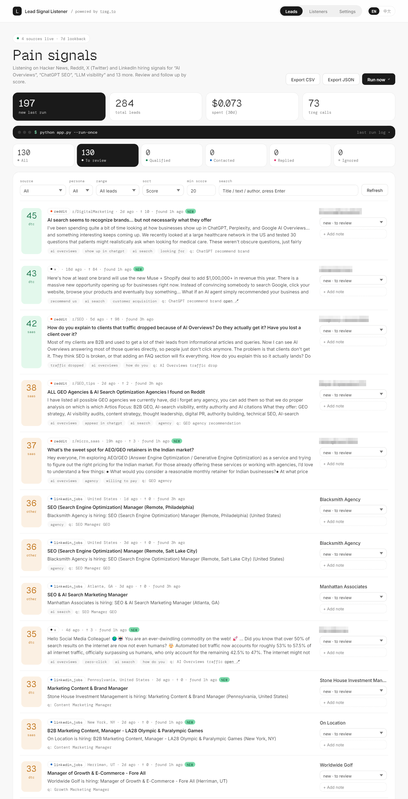
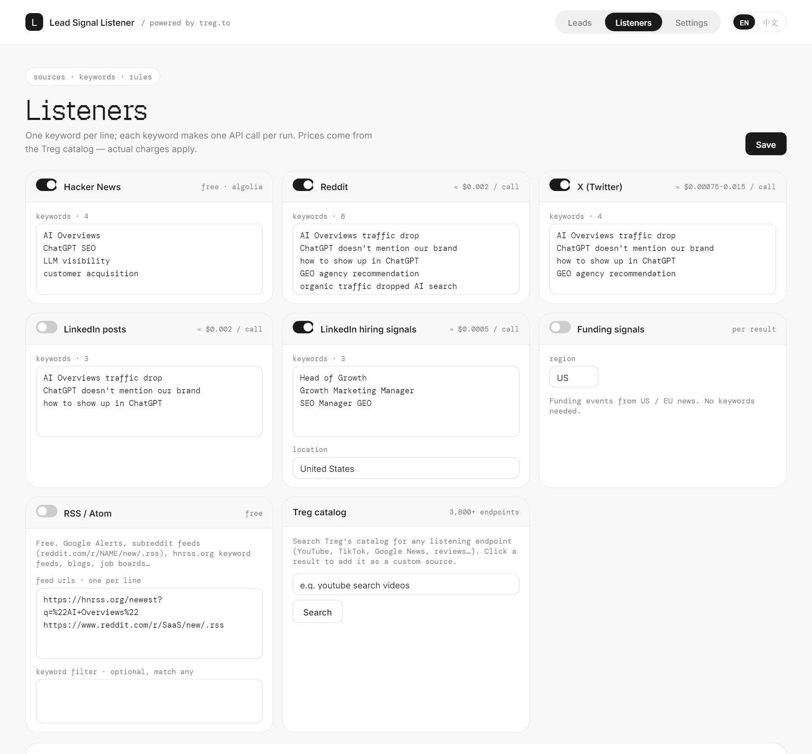

# Lead Signal Listener

**Find people who are publicly describing the problem you solve — before they find your competitors.**

Lead Signal Listener is a local, open-source lead discovery tool. It listens to Reddit, X, LinkedIn, Facebook, Instagram, Hacker News, YouTube, news, RSS feeds, and any of the 3,800+ endpoints in the [Treg](https://treg.to) catalog. It also picks up trigger signals such as hiring and funding. Every lead is scored, de-duplicated and queued, so you can review the best ones first.

[中文说明](README.zh-CN.md) · [Agent setup guide](AGENT_SETUP.md)

**Built by [newmax.ai](https://newmax.ai)** · **Powered by [treg.to](https://treg.to)**



<details>
<summary><b>More screenshots</b>: listeners configuration (Facebook / Instagram, pages per keyword, one-click agent prompt)</summary>



</details>

<sub>The leads screenshot shows real results from one run of the default keywords (284 leads, $0.073 in Treg calls), with personal usernames blurred. The listeners screenshot uses a demo configuration.</sub>

---

## Let your AI agent set it up

Copy this into Claude Code, Codex, Cursor, NewMax or any coding agent:

```
Read AGENT_SETUP.md from https://github.com/yangyixxxx/lead-signal-listener
and set up Lead Signal Listener for me. Walk me through choosing keywords and scoring rules.
```

The agent will install it, interview you about your buyer, propose keywords and scoring rules, run a first pass within your budget, and tune the results with you.

## Quick start

Requires Python 3.10+. **No third-party dependencies.**

```bash
git clone https://github.com/yangyixxxx/lead-signal-listener.git
cd lead-signal-listener
python app.py            # opens http://127.0.0.1:8787  (Windows: double-click start.bat)
```

1. **Settings** → paste your Treg token → Save → Verify
2. **Listeners** → describe who you're looking for, enable sources and add keywords (one per line)
3. **Leads** → **Run now**, review by score, set a status, add notes, export CSV/JSON

No token? The free sources still work: Hacker News, RSS and import.

The default keywords and scoring rules are only an **example** (finding companies that struggle with AI search visibility). Replace them with your own: any audience, any problem. The Leads page describes whatever you configure.

The UI defaults to English. Use the `EN / 中文` toggle in the top-right corner to switch.

## Ways to listen

| Method | Examples | Cost |
|---|---|---|
| **Built-in sources** | Reddit, X, LinkedIn posts, LinkedIn jobs (hiring signals), Facebook posts, Facebook groups, Instagram hashtags, Instagram Reels, funding news | Paid via Treg, ~$0.0005–0.03 per call |
| **Hacker News** | Stories and comments by keyword (Algolia API) | Free |
| **RSS / Atom** | Google Alerts, `reddit.com/r/NAME/new/.rss`, `hnrss.org/newest?q=...`, blogs, job boards, with an optional keyword filter | Free |
| **Any Treg endpoint** | YouTube, TikTok, Google News, reviews…: a params template plus optional field mapping | Paid via Treg |
| **Import** | `POST /api/import` or `python app.py --import leads.json`, for leads found by you or another agent | Free |

Find endpoints for custom sources without a token:

```bash
python app.py --catalog "youtube search videos"
```

You can also search the catalog in the UI (**Listeners → Treg catalog**). Clicking a result adds it as a custom source.

## Built-in Treg endpoints

| Source | Signal | Endpoint | Approx. price |
|---|---|---|---|
| Reddit | pain | `scrapecreators.reddit.search.posts` | $0.002 / call |
| X | pain | `treg.x.search.posts` (routed, cheapest provider first) | $0.00075–0.015 / call |
| LinkedIn posts | pain | `anyapi.linkedin.search.posts` | $0.002 / call |
| LinkedIn jobs | hiring | `anyapi.linkedin.search.jobs` | $0.0005 / call |
| Facebook posts | pain | `justoneapi.x.facebook-search-post-v1` | $0.03 / call |
| Facebook groups | pain | `anyapi.facebook.group.posts` (one public group URL per line) | $0.002 / call |
| Instagram hashtags | pain | `anyapi.instagram.hashtag.posts` (hashtags without `#`) | $0.002 / call |
| Instagram Reels | pain | `anyapi.instagram.search.reels` | $0.0015 / call |
| Funding | funding | `getleadsio.companies.funding.feed` | per result |

Prices are from the Treg catalog (Oct 2026). The `X-Treg-Cost-Micro` response header is authoritative. Each keyword fetches up to `max_pages` pages per run (default 3 for Reddit/X, 2 for LinkedIn; one page = one call). A run of the default config is about 50 calls, roughly **$0.07**.

## Cost control

- **Per-call cap**, enforced by Treg through `X-Treg-Route-Max-Cost`
- **Per-run budget**: paging and remaining paid calls stop once it's reached
- **Idempotent replay**: re-running the same query within an hour is not billed again
- **Auto-stop**: an invalid token (401) or empty balance (402) cancels the rest of the run
- Spend and call counts are shown on the Leads dashboard

## Scoring

The scoring is transparent, rule-based and free. Each lead is matched on:

- **pain** phrases ("traffic dropped", "doesn't mention us")
- **intent** phrases ("looking for", "recommend an agency")
- **persona** words (e.g. SaaS vs. DTC)
- engagement, and whether it's a question
- **negative** phrases (self-promotion, job posts, spam)

Edit the rules as JSON in **Listeners → Scoring rules**, then click **Rescore all leads** to apply them to existing leads. For deeper qualification, export JSON and pass it to an LLM.

## CLI

```bash
python app.py --port 9000                   # different port
python app.py --run-once                    # headless run (cron / Task Scheduler)
python app.py --data ~/listener-data        # custom data directory
python app.py --catalog "tiktok search"     # search the Treg catalog
python app.py --import leads.json           # import leads
TREG_TOKEN=... python app.py                # token from env, never written to disk
```

## Local API

The server listens on `127.0.0.1` only. Write requests must send `Content-Type: application/json`.

`GET /api/config` · `POST /api/config` · `POST /api/test-token` · `POST /api/run` · `GET /api/status` · `GET /api/signals` · `GET /api/signals/counts` · `POST /api/signals/<id>` · `POST /api/import` · `POST /api/rescore` · `GET /api/catalog?q=` · `GET /api/export?fmt=csv|json`

See [AGENT_SETUP.md](AGENT_SETUP.md#api-reference) for details.

## Data & security

- Everything stays on your machine: `data/config.json` (settings and token) and `data/signals.db` (SQLite).
- `data/` is git-ignored. **Never commit or share it.**
- Server binds to `127.0.0.1` and checks the `Host` header (blocks DNS rebinding). Writes require JSON.
- The token is masked in the UI and never logged. Team (identity) tokens automatically send `X-Treg-Org`.

## Responsible use

Only collect public content, and respect the terms of each platform and Treg provider. This is a research and lead discovery tool, not a spam cannon. Follow GDPR, CAN-SPAM and similar rules when you reach out.

## Project layout

```
app.py                  entry point (web UI, --run-once, --catalog, --import)
listener/
  treg_client.py        Treg HTTP client (cost, caps, idempotency, org header)
  sources.py            built-in sources + parsers
  generic.py            RSS/Atom, custom Treg endpoints, import, catalog search
  scoring.py            rule-based scoring
  store.py              SQLite storage + de-duplication + export
  runner.py             one listening pass
  server.py             local JSON API + scheduler
  i18n.py               server-side messages (en / zh)
  static/index.html     single-page UI (en / zh)
  static/fonts/         bundled OFL fonts (no Google Fonts dependency)
docs/                   screenshots
tests/                  unit tests (python -m unittest discover tests)
```

## License

[MIT](LICENSE)

---

## Credits

- **Built by [newmax.ai](https://newmax.ai)** — made by Yangyi · X: [@yangyi](https://x.com/yangyi)
- **Powered by [treg.to](https://treg.to)** — built by Jason Zhou · X: [@jasonzhou1993](https://x.com/jasonzhou1993)

If this project helps you, a ⭐ on GitHub and a follow on X are much appreciated.
