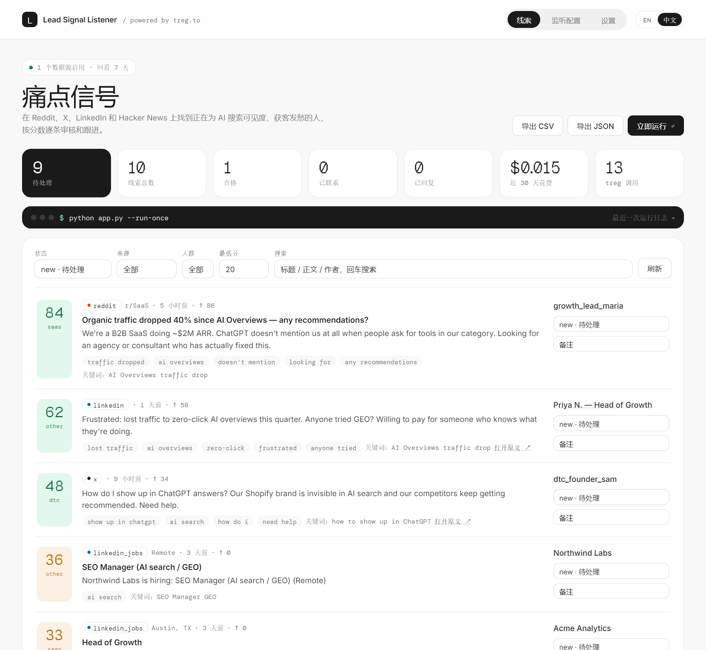
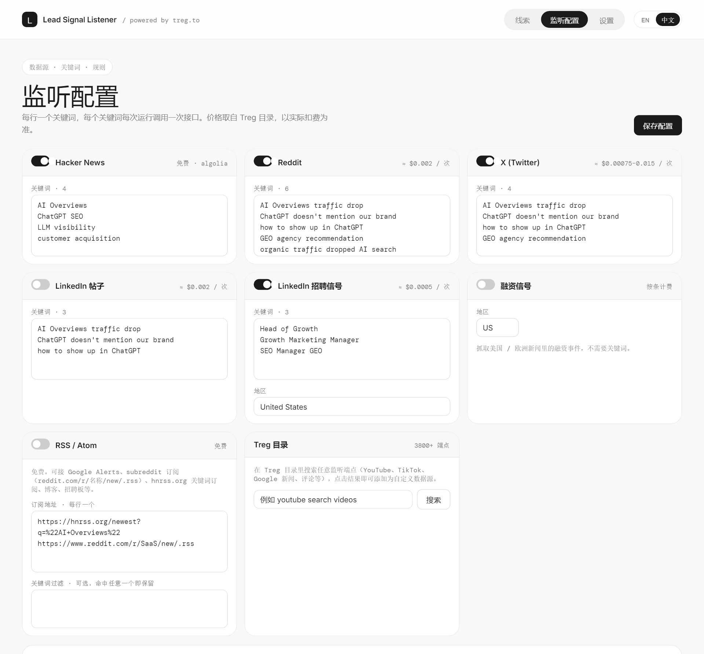

# Lead Signal Listener · 线索信号监听

**在潜在客户找到你的竞争对手之前，先找到那些正在公开描述你能解决的问题的人。**

Lead Signal Listener 是一个在本地运行的开源线索发现工具。它监听 Reddit、X、LinkedIn、Hacker News、YouTube、新闻、RSS 订阅，以及 [Treg](https://treg.to) 目录里 3800 多个端点中的任意一个，同时捕捉招聘、融资这类触发信号。每条线索都会自动打分、去重并进入待处理队列，你可以从分数最高的开始处理。

[English](README.md) · [Agent 初始化说明](AGENT_SETUP.md)



<details>
<summary><b>更多截图</b>：监听配置页</summary>



</details>

<sub>截图中的数据均为虚构的演示数据。</sub>

---

## 让 AI agent 帮你初始化

把下面这段话复制给 Claude Code、Codex、Cursor、NewMax 或任何编程 agent：

```
阅读 https://github.com/yangyixxxx/lead-signal-listener 里的 AGENT_SETUP.md，
帮我初始化 Lead Signal Listener，并引导我设置关键词和打分规则。
```

agent 会帮你安装项目，了解你的目标客户，提出关键词和打分规则的建议，在你的预算内跑第一轮，再和你一起调优结果。

## 快速开始

需要 Python 3.10 及以上版本，**不依赖任何第三方包**。

```bash
git clone https://github.com/yangyixxxx/lead-signal-listener.git
cd lead-signal-listener
python app.py            # 打开 http://127.0.0.1:8787（Windows 可双击 start.bat）
```

1. **Settings / 设置** → 粘贴 Treg token → 保存 → 校验
2. **Listeners / 监听配置** → 启用数据源，每行填一个关键词
3. **Leads / 线索** → 点「立即运行」，按分数审核，修改状态、写备注，导出 CSV / JSON

没有 token 也能用：Hacker News、RSS 和导入这几种免费方式照常工作。

界面默认英文，右上角的 `EN / 中文` 可以切换，选择会保存在浏览器里，运行日志也会跟着切换语言。

## 监听方式

| 方式 | 例子 | 费用 |
|---|---|---|
| **内置数据源** | Reddit、X、LinkedIn 帖子、LinkedIn 招聘（招聘信号）、融资新闻 | 通过 Treg 按次付费，约 $0.0005–0.015/次 |
| **Hacker News** | 按关键词搜帖子和评论（Algolia API） | 免费 |
| **RSS / Atom** | Google Alerts、`reddit.com/r/名称/new/.rss`、`hnrss.org/newest?q=...`、博客、招聘板，可加关键词过滤 | 免费 |
| **任意 Treg 端点** | YouTube、TikTok、Google 新闻、评论等，配置参数模板，字段映射可选 | 通过 Treg 付费 |
| **导入** | `POST /api/import` 或 `python app.py --import leads.json`，导入你或其他 agent 找到的线索 | 免费 |

不需要 token 就能搜索自定义数据源可用的端点：

```bash
python app.py --catalog "youtube search videos"
```

也可以在界面里搜索（**监听配置 → Treg catalog**），点击结果即可添加为自定义数据源。

## 内置的 Treg 端点

| 来源 | 信号类型 | 端点 | 参考单价 |
|---|---|---|---|
| Reddit | 痛点 | `scrapecreators.reddit.search.posts` | $0.002/次 |
| X | 痛点 | `treg.x.search.posts`（路由，最便宜的优先） | $0.00075–0.015/次 |
| LinkedIn 帖子 | 痛点 | `anyapi.linkedin.search.posts` | $0.002/次 |
| LinkedIn 招聘 | 招聘 | `anyapi.linkedin.search.jobs` | $0.0005/次 |
| 融资 | 融资 | `getleadsio.companies.funding.feed` | 按返回条数计费 |

单价取自 2026 年 10 月的 Treg 目录，以响应头 `X-Treg-Cost-Micro` 为准。每个关键词每次运行调用一次接口。按默认配置跑一次大约 **$0.02**。

## 花费控制

- **单次调用上限**：通过 `X-Treg-Route-Max-Cost` 由 Treg 强制执行
- **单次运行预算**：达到后跳过剩下的付费调用
- **幂等重放**：同一关键词一小时内重复运行，不重复计费
- **自动停止**：Token 无效（401）或余额不足（402）时，取消本次运行剩下的调用
- 花费和调用次数显示在线索页的统计卡片上

## 打分

打分基于规则，结果透明，不额外花钱。每条线索按以下几项匹配：

- **痛点**短语，比如 "traffic dropped" "doesn't mention us"
- **意图**短语，比如 "looking for" "recommend an agency"
- **人群**词，比如 SaaS 和 DTC
- 互动量，以及是不是提问
- **负面**短语：自我推广、招聘帖、垃圾内容

规则可以在 **监听配置 → 打分规则** 里以 JSON 编辑，然后点「重新打分全部线索」，让已有线索也按新规则计算。需要更精细的判断时，可以导出 JSON 交给 LLM 处理。

## 命令行

```bash
python app.py --port 9000                   # 换端口
python app.py --run-once                    # 无界面运行一次（适合 cron / 计划任务）
python app.py --data D:/listener-data       # 指定数据目录
python app.py --catalog "tiktok search"     # 搜索 Treg 目录
python app.py --import leads.json           # 导入线索
TREG_TOKEN=... python app.py                # 用环境变量提供 token，不写入磁盘
```

## 数据与安全

- 所有数据都在本机：`data/config.json`（配置和 token）、`data/signals.db`（SQLite）
- `data/` 已加入 `.gitignore`，**不要提交或分享**
- 服务只监听 `127.0.0.1`，校验 `Host` 请求头以防 DNS 重绑定；写操作只接受 JSON 请求
- Token 在界面上脱敏显示，不会写进日志。团队（identity）token 会自动带上 `X-Treg-Org`

## 合规使用

只抓取公开内容，遵守各平台和 Treg 上游服务商的条款。这是研究和线索发现工具，不要用来群发垃圾信息。外联时注意 GDPR、CAN-SPAM 等规定。

## 许可证

[MIT](LICENSE)

---

Made by [@yangyi](https://x.com/yangyi) · built by [newmax.ai](https://newmax.ai)
